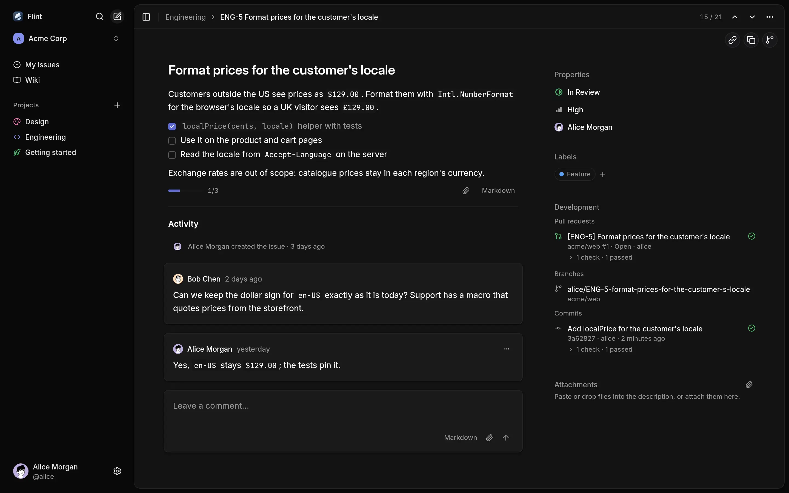

<p align="center"></p>

<h1 align="center">Flint</h1>

<p align="center"></p>

Flint is a self-hosted issue tracker and Markdown wiki for teams that run [Gitea](https://about.gitea.com). People sign in with their Gitea accounts, and branches, commits, pull requests and CI checks that mention `ENG-12` show up on the issue by themselves. A CLI does everything the UI does, so coding agents can work in it too.

- Lists and boards, priorities, labels, assignees, keyboard shortcuts and a command palette.
- Markdown wiki with revision history, Mermaid diagrams and conflict recovery.
- Comments, attachments and live updates across tabs.
- Full-text search; optional semantic search through an embeddings API.
- REST API and a CLI that prints JSON when piped.

## Contents

- [Quick start](#quick-start)
- [Self-hosting](#self-hosting)
- [CLI and agent skill](#cli-and-agent-skill)
- [Limitations](#limitations)
- [Development](#development)

## Quick start

You need [Bun](https://bun.sh) and Docker Compose. Compose runs PostgreSQL, an S3 server, Gitea with a CI runner, and creates the Gitea users, the OAuth app and the webhook.

```sh
git clone https://github.com/yegor-usoltsev/flint.git && cd flint
bun install
cp .env.example .env
docker compose up -d --wait
bun run dev    # or the production image: bun run build && docker compose --profile app up -d --wait --build
bun run demo   # optional, while Flint is running
```

Open <http://localhost:4700>, choose **Continue with Gitea** and sign in as `alice` with the password `password` (`bob` and `carol` too). Gitea is on <http://localhost:4701>.

`bun run demo` creates the workspace Acme Corp with projects, issues, wiki pages and a Getting started project that tours the features, plus a Gitea repository whose pull request shows up on ENG-5 with its CI check. Without it, Flint asks you to create a workspace; tick **Include demo data** there for a short Getting started project and wiki guide.

To open Flint from another device, set `PUBLIC_HOST` (the host name the browser uses) and `PUBLIC_HOST_BIND` (the address to publish on) in `.env`, then rerun `docker compose up -d` and restart `bun run dev`. `docker compose down -v` deletes all data.

## Self-hosting

Run `yusoltsev/flint` (also `ghcr.io/yegor-usoltsev/flint`) next to Gitea, PostgreSQL 18 with pgvector and an S3 bucket:

```sh
docker run -d --name flint -p 3000:3000 --env-file flint.env yusoltsev/flint:latest
```

[docs/self-hosting.md](docs/self-hosting.md) covers the Gitea OAuth app and webhook, the reverse proxy and semantic search.

## CLI and agent skill

```sh
npm install -g @yusoltsev/flint-cli    # Node 22.12+ or Bun
flint login --url https://flint.example.com --token <key from Settings → API keys>
flint issue list -a @me
```

```console
$ flint issue branch ENG-5
alice/ENG-5-format-prices-for-the-customer-s-locale
```

For a coding agent, `npx skills add yegor-usoltsev/flint` installs a skill that tells it to run `flint skill`, which prints the guide for the installed CLI version. More in [cli/README.md](cli/README.md).

## Limitations

- **Gitea only.** Sign-in and Git links need Gitea. Links come from every repository on the instance, private ones included, and every workspace member sees them.
- **No notifications** by email or in the app.
- **Fixed statuses.** Every project has Backlog, Todo, In Progress, In Review, Done and Canceled.
- **My issues** has no filters, grouping or ordering.
- **Escape** on an issue opened from Cmd+K returns to the project list, not the previous view.
- **One container.** Live updates reach only tabs connected to the same server process.
- **HTTP/1.1.** Each visible tab holds an event stream and browsers open six HTTP/1.1 connections per host, so over HTTP/1.1, including the local stack, a sixth Flint window visible at the same time stalls. Hidden tabs close their stream and refresh when shown.
- **Images.** JPEG and static PNG and WebP uploads are scaled and stripped of metadata; GIF, AVIF, HEIC, APNG and animated WebP are stored as is.

## Development

[mise](https://mise.jdx.dev) installs Bun and the pre-commit hook. `bun run lint` checks types and formatting, `bun test` runs against the compose PostgreSQL and S3, and `bun run cli:smoke` drives the CLI against the running app after `bun run demo`. [AGENTS.md](AGENTS.md) and [docs/development.md](docs/development.md) hold the conventions.

## License

[MIT](LICENSE)
