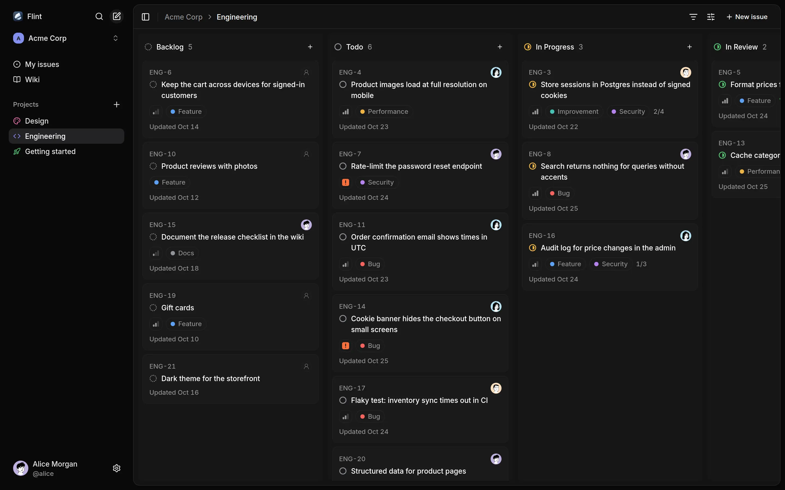
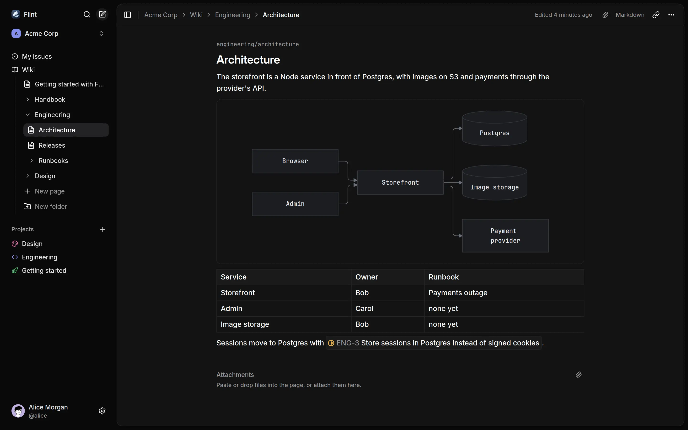
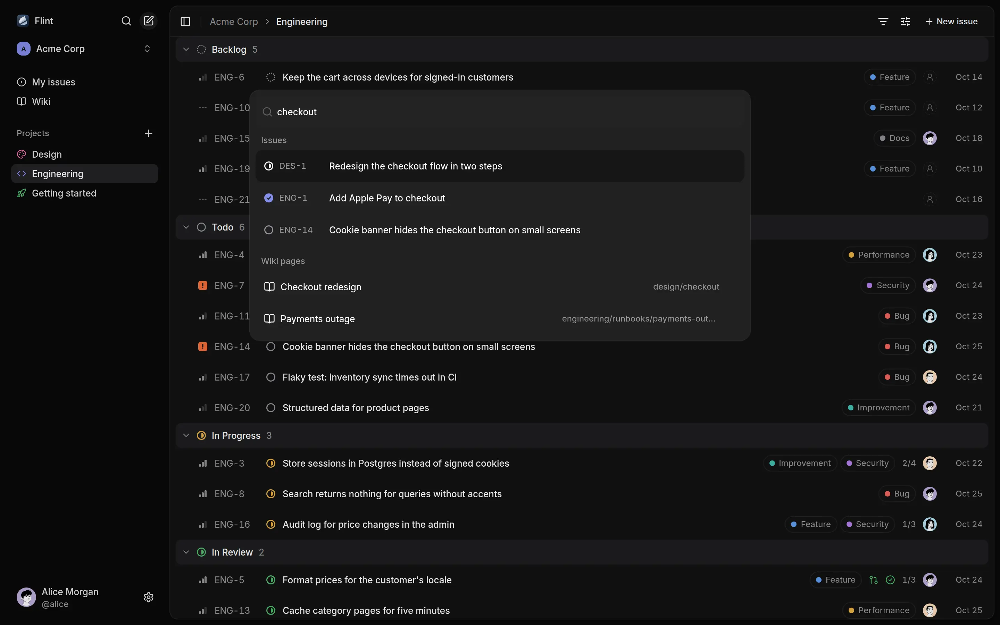

<p align="center"></p>

<h1 align="center">Flint</h1>

<p align="center"></p>

Flint is a self-hosted issue tracker and Markdown wiki for teams that run [Gitea](https://about.gitea.com). People sign in with their Gitea accounts, and branches, commits, pull requests and CI checks that mention `ENG-12` show up on the issue by themselves. A CLI does everything the UI does, so coding agents can work in it too.



- **Issues.** Lists and boards with drag and drop, filters in the URL, single-key shortcuts, multi-select, a Cmd+K palette, checklists, comments, activity history and attachments.
- **Gitea links.** One system webhook links branches, commits and pull requests with their state and CI checks. Flint never writes to Gitea.
- **Live updates.** Open tabs update as soon as someone, or the CLI, changes something.

<br clear="right">



- **Wiki.** A tree of Markdown pages and folders per workspace with autosave, revision history and a conflict view that keeps unsaved text.
- **Editor.** Slash menu, tables, highlighted code, Mermaid diagrams, pasted images, video and audio, and live `ENG-12` chips.
- **Small stack.** One Bun container, PostgreSQL 18 with pgvector and any S3-compatible storage.

<br clear="right">



- **Search.** Full-text, plus semantic search with an embeddings API key, so a Russian query finds an English issue.
- **CLI for agents.** `flint` prints JSON when piped, and `flint skill` prints a guide for agents.

<br clear="right">

## Contents

- [Quick start](#quick-start)
- [Self-hosting](#self-hosting)
- [CLI and agent skill](#cli-and-agent-skill)
- [Flint and Linear](#flint-and-linear)
- [Known issues and limitations](#known-issues-and-limitations)
- [Development](#development)

## Quick start

You need [Bun](https://bun.sh) and Docker Compose. Compose runs PostgreSQL, an S3 server, Gitea with a CI runner, and creates the Gitea users, the OAuth app and the webhook.

```sh
git clone https://github.com/yegor-usoltsev/flint.git && cd flint
bun install
cp .env.example .env
docker compose up -d --wait
bun run dev    # or the production image: bun run build && docker compose --profile app up -d --wait --build
bun run demo   # optional, while Flint is running
```

Open <http://localhost:4700>, choose **Continue with Gitea** and sign in as `alice` with the password `password` (`bob` and `carol` too). Gitea is on <http://localhost:4701>.

`bun run demo` creates the workspace Acme Corp with projects, issues, wiki pages and a Getting started project that tours the features, plus a Gitea repository whose pull request shows up on ENG-5 with its CI check. Without it, Flint asks you to create a workspace; tick **Include demo data** there for a short Getting started project and wiki guide.

To open Flint from another device, set `PUBLIC_HOST` (the host name the browser uses) and `PUBLIC_HOST_BIND` (the address to publish on) in `.env`, then rerun `docker compose up -d` and restart `bun run dev`. `docker compose down -v` deletes all data.

## Self-hosting

Run `yusoltsev/flint` (also `ghcr.io/yegor-usoltsev/flint`) next to Gitea, PostgreSQL 18 with pgvector and an S3 bucket:

```sh
docker run -d --name flint -p 3000:3000 --env-file flint.env yusoltsev/flint:latest
```

[docs/self-hosting.md](docs/self-hosting.md) covers the Gitea OAuth app and webhook, the reverse proxy and semantic search.

### Configuration

| Variable | Default | Description |
| --- | --- | --- |
| `APP_URL` | required | Flint's public origin, such as `https://flint.example.com` |
| `DATABASE_URL` | required | PostgreSQL 18 with pgvector |
| `GITEA_URL` | required | Gitea as Flint's server reaches it, possibly internal |
| `GITEA_PUBLIC_URL` | required | Gitea as browsers reach it |
| `GITEA_CLIENT_ID`, `GITEA_CLIENT_SECRET` | required | Gitea OAuth2 application |
| `GITEA_WEBHOOK_SECRET` | required | Secret of the Gitea system webhook |
| `S3_ENDPOINT`, `S3_BUCKET`, `S3_ACCESS_KEY_ID`, `S3_SECRET_ACCESS_KEY` | required | S3-compatible storage for attachments |
| `S3_REGION` | `auto` | Region of the S3 bucket |
| `MAX_UPLOAD_BYTES` | `26214400` (25 MB) | Largest attachment in bytes, at least `1048576` (1 MB); Bun caps request bodies at 128 MB |
| `TRASH_RETENTION_DAYS` | `30` | Days before deleted issues and pages are purged |
| `TRASH_PURGE_CRON` | `0 0 * * *` | Schedule of the trash purge |
| `STORAGE_SWEEP_CRON` | `1 0 * * 0` | Schedule of the sweep of orphaned uploads |
| `EMBEDDING_API_KEY` | empty | Turns on semantic search |
| `EMBEDDING_API_URL` | `https://openrouter.ai/api/v1` | Any OpenAI-compatible `/embeddings` API |
| `EMBEDDING_MODEL` | `perplexity/pplx-embed-v1-0.6b` | Must return 1024 dimensions |
| `PORT` | `3000` | Listening port |

Cron schedules use the container's time zone, UTC unless `TZ` is set. For the local stack, `.env.example` also sets `PUBLIC_HOST` and `PUBLIC_HOST_BIND` ([Quick start](#quick-start)) and `GITEA_ADMIN_USER` and `GITEA_ADMIN_PASSWORD`, the Gitea site admin the `gitea:*` scripts sign in as.

## CLI and agent skill

```sh
npm install -g @yusoltsev/flint-cli    # Node 22.12+ or Bun
flint login --url https://flint.example.com --token <key from Settings → API keys>
flint issue list -a @me
```

```console
$ flint issue branch ENG-5
alice/ENG-5-format-prices-for-the-customer-s-locale
```

For a coding agent, `npx skills add yegor-usoltsev/flint` installs a skill that tells it to run `flint skill`, which prints the guide for the installed CLI version. More in [cli/README.md](cli/README.md).

## Flint and Linear

Flint borrows Linear's keyboard-first lists, boards and Cmd+K palette. The differences:

|  | Flint | Linear |
| --- | --- | --- |
| Hosting | Self-hosted, MIT | Hosted service |
| Git | Gitea: branches, commits, pull requests, CI checks; statuses change only by hand | GitHub and GitLab; pull requests move issue statuses |
| Planning | Projects, fixed statuses, priorities, labels, one assignee, checklists | Also cycles, roadmaps, estimates, due dates, sub-issues, relations, custom workflows, triage |
| Docs | Workspace wiki tree with revisions | Documents in projects |
| Notifications | None | Inbox, email, Slack, mobile apps |
| API | REST and a CLI with an agent guide | GraphQL and an MCP server |

Pick Flint if your code lives in Gitea and a small team wants issues and docs on its own servers; pick Linear for planning features and integrations.

## Known issues and limitations

- **Gitea only.** Sign-in and Git links need Gitea. Links come from every repository on the instance, private ones included, and every workspace member sees them.
- **No notifications** by email or in the app.
- **Fixed statuses.** Every project has Backlog, Todo, In Progress, In Review, Done and Canceled.
- **My issues** has no filters, grouping or ordering.
- **Escape** on an issue opened from Cmd+K returns to the project list, not the previous view.
- **One container.** Live updates reach only tabs connected to the same server process.
- **HTTP/1.1.** Visible tabs of the same build share one event stream per account and workspace when SharedWorker is available. Older builds and browsers with unavailable or failed workers keep a stream per visible tab and can exhaust the six HTTP/1.1 connections per host. Hidden tabs unsubscribe and refresh when shown; use HTTP/2 to avoid the connection limit.
- **Images.** JPEG and static PNG and WebP uploads are scaled and stripped of metadata; GIF, AVIF, HEIC, APNG and animated WebP are stored as is.

## Development

[mise](https://mise.jdx.dev) installs Bun and the pre-commit hook. `bun run lint` checks types and formatting, `bun test` runs against the compose PostgreSQL and S3, and `bun run cli:smoke` drives the CLI against the running app after `bun run demo`. [AGENTS.md](AGENTS.md) and [docs/development.md](docs/development.md) hold the conventions.

## License

[MIT](LICENSE)
