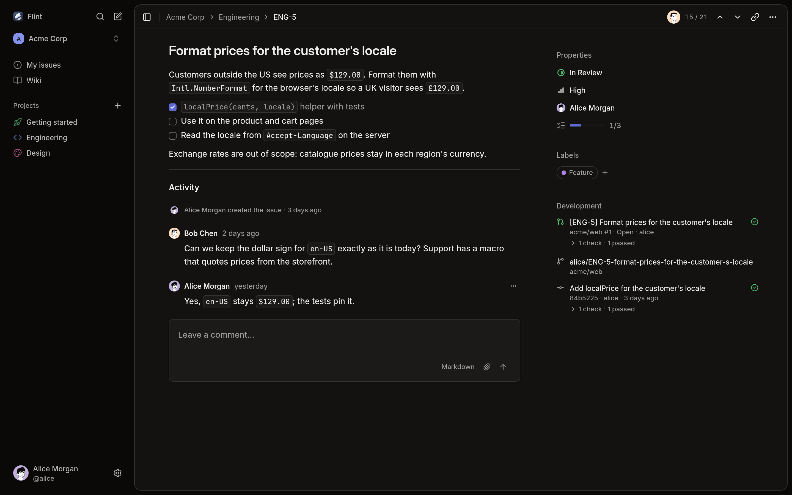

<p align="center"></p>

<h1 align="center">Flint</h1>

<p align="center">
  <a href="https://github.com/yegor-usoltsev/flint/actions"></a>
  <a href="https://codecov.io/github/yegor-usoltsev/flint"></a>
  <a href="https://github.com/yegor-usoltsev/flint/releases"></a>
  <a href="https://www.npmjs.com/package/@yusoltsev/flint-cli"></a>
  <a href="https://hub.docker.com/r/yusoltsev/flint"></a>
  <a href="https://github.com/yegor-usoltsev/flint/pkgs/container/flint"></a>
  <a href="https://hub.docker.com/r/yusoltsev/flint/tags"></a>
</p>

<p align="center"></p>

Flint is a self-hosted issue tracker and Markdown wiki for teams on [Gitea](https://about.gitea.com). People sign in with their Gitea accounts, and any branch, commit or pull request that mentions `ENG-12` shows up on that issue with its CI checks. A CLI does everything the UI does, so coding agents can work in Flint too.

- **Issues:** lists, boards, labels, checklists, keyboard shortcuts and a Cmd+K command menu.
- **Wiki:** nested pages with revision history, Mermaid diagrams and issue links.
- **Search:** full text, plus optional semantic search through an embeddings API.
- **Live:** edits and comments reach every open tab.

## Quick start

You need [Bun](https://bun.sh) and Docker Compose.

```sh
git clone https://github.com/yegor-usoltsev/flint.git && cd flint
bun install
cp .env.example .env
docker compose up -d --wait   # PostgreSQL, S3, and Gitea with users and a CI runner
bun run dev                   # leave it running
bun run demo                  # in a second terminal
```

Open <http://localhost:4700>, choose **Continue with Gitea** and sign in as `alice` with the password `password` (or `bob`, or `carol`). The demo fills the Acme Corp workspace with issues, comments and wiki pages, and opens a pull request in Gitea (<http://localhost:4701>) that shows up on ENG-5. Without it, Flint first asks for a workspace, and **Include demo data** there adds a Getting started project and wiki page.

To use Flint from another device, set `PUBLIC_HOST` in `.env` to this machine's IP or host name (the app and Gitea URLs follow it) and `PUBLIC_HOST_BIND` to `0.0.0.0` so Gitea listens on the network too (the dev server already does), rerun `docker compose up -d --wait`, restart `bun run dev` and open `http://<PUBLIC_HOST>:4700`. Anyone who reaches that address can then sign in to Gitea as `alice`, a site admin, with the password `password`, so publish only on a network you trust. `docker compose down -v` deletes all data.

## Self-hosting

Run the `yusoltsev/flint` image next to Gitea, PostgreSQL and an S3 bucket, as [docs/self-hosting.md](docs/self-hosting.md) describes.

## CLI and coding agents

```console
$ npm install -g @yusoltsev/flint-cli
$ flint login --url https://flint.example.com
$ flint issue branch ENG-5
alice/ENG-5-format-prices-for-the-customer-s-locale
```

`npx skills add yegor-usoltsev/flint` teaches a coding agent to use it. More in [cli/README.md](cli/README.md).

## Limitations

- **Gitea only**, and every workspace member sees links from every repository on the instance, private ones included.
- **No notifications** by email or in the app.
- **Fixed statuses:** Backlog, Todo, In Progress, In Review, Done and Canceled.
- **One container per database:** live updates reach only tabs connected to the container that made the change.
- **Offline edits:** unsaved issue and page text stays in the browser as a draft, which signing in as another user clears. An open editor whose save failed on a network error, rate limit or server error retries once on reconnect, and a conflict asks you to choose. Drafts restored after a reload, closed editors and rolled-back property edits do not retry.
- **Images:** only static JPEG, PNG and WebP are scaled down and stripped of metadata; GIF, AVIF, HEIC, APNG and animated WebP are stored as uploaded.

## Development

[docs/development.md](docs/development.md) covers worktrees, Codespaces and releases; [AGENTS.md](AGENTS.md) holds the checks and code conventions.

## License

[MIT](LICENSE)
